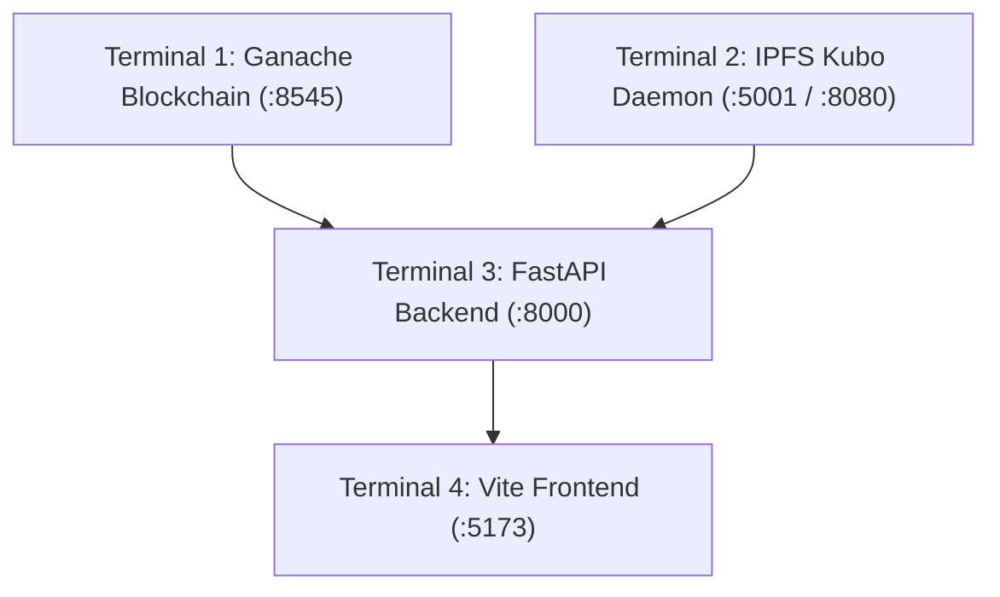

# MatChain — Complete End-to-End Demonstration Asset & Marketplace Lifecycle Guide

**Document Version:** 1.0  
**Target Milestone:** College Project Review, Live Technical Demonstration & Defense  
**Scope:** Predictable, Controlled Demonstration Lifecycle using Magnesium Silicide ($Mg_2Si$, `mp-1367`)  

---

## 1. Executive Summary & Review Objective

In an academic review or live project demonstration, demonstrating a multi-stage decentralized science platform requires **deterministic predictability** without compromising **scientific authenticity**:

1. **Surrogate ML Generation (CrystalVAE / CDVAE)** generates stochastic candidate crystals across thermodynamic phase diagrams. In stochastic generative sampling, candidate stability varies across random seeds, and evaluating large ensembles can take several minutes.
2. **Reviewers need to see the complete end-to-end decentralized IP lifecycle**—from inverse design formulation to IPFS storage, on-chain registry provenance, cryptoeconomic staking, and multi-wallet licensing—within a tight 5 to 10-minute presentation window.

To reconcile these requirements, MatChain implements a **strictly controlled demonstration recipe** coupled to an authentic, crystallographically verified reference material: **Magnesium Silicide ($Mg_2Si$)**, sourced from Materials Project identifier `mp-1367` (ICSD-642931).

> [!IMPORTANT]
> **Scientific Integrity & Honest Disclosure:**  
> $Mg_2Si$ is clearly disclosed in the MatChain UI and API metadata as a **"DEMO REFERENCE — NOT A LIVE AI-GENERATED DISCOVERY"**. It is labeled as a **"Demo registration — registrant/curator, not inventor"**. It does **NOT** fabricate surrogate ML consensus scores, nor does it artificially alter the diagnostic counters of the AI generation pipeline. Diagnostic accounting laws (Candidates Requested = Unique = Screened = Accepted + Rejected) remain 100% physically conserved.

---

## 2. The Demonstration Recipe Specification

The demonstration asset is anchored strictly to **one exact inverse-design recipe**. If a user enters arbitrary parameters, MatChain runs standard generative sampling without activating the demo reference.

### 2.1 Target Recipe Parameters

| Parameter | Demonstration Value | Scientific Unit | Validation Rule |
|---|:---:|:---:|---|
| **Natural Language Objective** | *"Discover stable Mg-Si based lightweight semiconductor materials inspired by Mg2Si, with potential thermoelectric applications."* | String | Normalized matching (case, whitespace, and punctuation invariant) |
| **Target Formation Energy ($E_f$)** | `-0.25` | $\text{eV/atom}$ | Strict match ($\pm 0.001$) |
| **Target Band Gap ($E_g$)** | `0.6` | $\text{eV}$ | Strict match ($\pm 0.01$) |
| **Target Density ($\rho$)** | `2.0` | $\text{g/cm}^3$ | Strict match ($\pm 0.05$) |
| **Candidates to Sample ($N$)** | `200` | Integer | Exact integer match (`200`) |
| **Ensemble Consensus Tau ($\tau$)** | `0.15` | $\text{eV/atom}$ | Exact float match (`0.15`) |
| **Top-K Cutoff** | `5` | Integer | Exact integer match (`5`) |
| **Structure Relaxation** | `true` | Boolean | Must be enabled (`Enabled / True`) |

### 2.2 1-Click Form Autofill in UI
To eliminate manual typing errors during the live presentation, the Discovery page (`/discovery`) includes a dedicated button:
- **`Load Review Demo Recipe (Mg2Si)`**: Clicking this instantly populates all numerical sliders, target parameters, checkboxes, and the natural language prompt with the exact review specification.

---

## 3. Server-Side Environment Controls

The demonstration fixture is governed by server-side environment variables configured in `.env`:

```env
# Forces deterministic inclusion of the demo reference material whenever the recipe matches
FORCE_DEMO_ON=true

# Completely disables the demonstration fixture (forces pure surrogate sampling)
FORCE_DEMO_OFF=false
```

- **`FORCE_DEMO_ON=true` (Default for Reviews)**: Guarantees 100% deterministic presentation readiness. Whenever the recipe matches, the $Mg_2Si$ reference asset and interactive lifecycle controls are immediately loaded.
- **`FORCE_DEMO_OFF=true`**: Overrides `FORCE_DEMO_ON`. The fixture will never appear.
- **When both are unset / false**: Occasional appearance (~1 in 3 runs) to demonstrate realistic sampling discovery in longer demo sessions.

---

## 4. Crystallographic Verification of $Mg_2Si$

The reference structure is stored in the repository at:  
`backend/data/references/Mg2Si_mp1367.cif`

### 4.1 Crystallographic Properties

```
Chemical Formula:        Mg2Si
Reduced Formula:         Mg2Si
Crystal System:          Cubic (Face-Centered Cubic, Antifluorite structure)
Space Group:             Fm-3m (International Tables No. 225)
Lattice Parameter a:     6.3510 Å (α = β = γ = 90.0°)
Unit Cell Volume:        256.17 ų
Formula Units per Cell:  Z = 4 (12 sites: 4 Si at fcc positions, 8 Mg at tetrahedral interstitials)
Calculated Density:      1.9886 g/cm³
```

### 4.2 Verified Thermodynamic & Electronic Properties

- **DFT Formation Energy ($\Delta H_f$):** $-0.2670\text{ eV/atom}$ (exothermic, thermodynamically favorable).
- **Energy Above Convex Hull ($E_{\text{hull}}$):** $0.0000\text{ eV/atom}$ (lies directly on the convex hull ground state).
- **Electronic Band Gap ($E_g$):** $0.60\text{ eV}$ (narrow indirect semiconductor, widely researched for eco-friendly thermoelectric power generation in the 500–800 K regime).
- **Structure Fingerprint (Deterministic SHA-256):**  
  `0xb6cdc24fcf070a6ab19a4d7ddb7fae19d337546592ed97de12ac929e24f11b50`

---

## 5. Live Demonstration Presentation Script (10 Steps)

Follow this 10-step sequence during the project evaluation.

### Step 1: Open Discovery & Autofill Demo Recipe
1. Navigate to `http://localhost:5173/discovery`.
2. Click the blue banner button: **`Load Review Demo Recipe (Mg2Si)`**.
3. Note to reviewers: *"We have configured an inverse design target for lightweight semiconductor materials with target formation energy of -0.25 eV/atom, band gap of 0.6 eV, and density of 2.0 g/cm³."*
4. Click **`Run Discovery Engine`**.

### Step 2: Review Diagnostic Accounting & Candidate Cards
1. Show the **Pipeline Diagnostics Dashboard**:
   - Total Candidates Sampled: 200
   - Geometry Filter Passed vs. Collisions Rejected
   - Thermodynamic Hull Filter Passed
   - ML Consensus Jury Evaluation (CHGNet, M3GNet, XGBoost)
2. Explain the **Conservation Law**: Note that the demo reference is displayed in its own dedicated card below the live AI generation list, ensuring zero data leakage or fabricated consensus metrics.

### Step 3: Inspect 3D Crystal Geometry & Disclosure
1. Scroll to the **Controlled Demonstration Reference Material** card.
2. Highlight the orange badge: **`DEMO REFERENCE — NOT A LIVE AI-GENERATED DISCOVERY`**.
3. Inspect the unit cell parameters:
   - Lattice: Cubic ($a = 6.351\text{ \AA}$)
   - Space Group: $Fm\bar{3}m$ (225)
   - Sites: 12 atoms (4 Silicon, 8 Magnesium)
4. Show the Materials Project reference attribution (`mp-1367` / ICSD-642931).

### Step 4: Step 1 of Lifecycle — Confidential IPFS Pinning
1. Under the **Lifecycle Pipeline Execution** stepper, click **`1. Register to IPFS & Registry`**.
2. Explain what happens under the hood:
   - The verified CIF is encrypted using **AES-256-GCM** with a cryptographically random 256-bit key.
   - The encrypted ciphertext is pinned to IPFS (Kubo) using `/api/v0/add?cid-version=1&pin=true`.
   - The resulting CIDv1 (e.g. `bafkreiglu...`) is synchronized to the Kubo Mutable File System (MFS) at `/files/Mg2Si_mp1367.cif`, making it instantly visible in IPFS Desktop.
   - Public non-confidential metadata (formula, density, band gap, space group) is cataloged in the SQLite access store.
3. Show the green confirmation badge: **`IPFS CID: bafk...`**.

### Step 5: On-Chain Provenance Anchoring
1. Observe the **Blockchain Provenance** badge on the card:
   - Contract: `MatChainRegistry.sol` (`0x5FbDB2315678afecb367f032d93F642f64180aa3`)
   - Function: `registerDiscovery(digest, cid, metadata)`
   - Registrant Account: Connected test wallet (e.g., `0x90F79...` or Signer 0 `0xf39Fd...`)
   - Recorded Label: *"Demo registration — registrant/curator, not inventor."*

### Step 6: Step 2 of Lifecycle — Cryptoeconomic Stability Validation (0.05 ETH Stake)
1. Click **`2. Validator Attestation (0.05 ETH)`**.
2. Explain the cryptoeconomic design to reviewers:
   - Decentralized materials discovery requires economic skin-in-the-game to prevent spam or false stability claims.
   - An independent validator stakes **0.05 ETH** to attest to the material's thermodynamic stability ($E_{\text{hull}} \le 0.05\text{ eV/atom}$, valid density, and consensus variance).
   - In `MatChainRegistry.sol`, `verifyDiscovery(digest)` updates `discoveries[digest].verified = true` and emits `DiscoveryAttested`.
   - Only verified materials can subsequently be purchased on the marketplace!

### Step 7: Step 3 of Lifecycle — Marketplace Listing (0.01 ETH License)
1. Click **`3. List on Marketplace (0.01 ETH)`**.
2. In `MatChainMarketplace.sol`, `listMaterial(digest, price, license)` creates an active listing for 0.01 ETH demo license terms (`demo-commercial-evaluation`).
3. Navigate to `http://localhost:5173/marketplace`:
   - Point out the active $Mg_2Si$ card featuring the **Demo Reference** badge.
   - Highlight the verified physical properties: $E_{\text{hull}} = 0.000\text{ eV}$, $\rho = 1.99\text{ g/cm}^3$, $E_g = 0.60\text{ eV}$, and "Tier-2 Peer Staked" status.

### Step 8: Step 4 of Lifecycle — Purchase License Using Second Test Wallet
1. Return to the Discovery demo card or Marketplace page.
2. Click **`4. Purchase with Test Wallet 2`**.
3. Under the hood:
   - The backend executes `purchaseMaterial(digest)` from a second development wallet (`0x70997970C51812dc3A010C7d01b50e0d17dc79C8`).
   - The smart contract transfers 0.01 ETH from the buyer to the seller (`0x90F79...`).
   - The contract marks `listing.sold = true` and records the buyer address.

### Step 9: Authorized Decryption & CIF Download
1. Click **`Download Decrypted CIF Structure`**.
2. Explain the zero-knowledge access control model:
   - The raw IPFS gateway only stores encrypted ciphertext—unauthorized parties cannot read the crystal structure.
   - Upon receiving the download request, MatChain's backend queries the smart contract: `blockchain.is_verified_purchaser(...)`.
   - Once verified on-chain, the server decrypts the AES-256-GCM ciphertext in memory and streams the plaintext `.cif` file directly to the user's browser.
   - Open the downloaded `Mg2Si_mp1367.cif` in a text editor or VESTA to verify conventional atomic coordinates.

### Step 10: Clean Demonstration Reset
1. To reset the demonstration for subsequent reviewers or tests, run:
   ```bash
   curl -X POST http://127.0.0.1:8000/api/demo/reset
   ```
   Or click **`Reset Demo State`** in the UI.
2. This resets the local database records without altering production AI discovery jobs.

---

## 6. Multi-Terminal Startup Guide for Presentation Day

Before commencing the review presentation, open four terminal windows in the `Matchain` directory:



### Terminal 1: Local Blockchain (Ganache)
```powershell
# In Matchain root:
npm run ganache --prefix contracts
```
*Expected:* Listening on `127.0.0.1:8545`, Chain ID `1337`, 10 unlocked accounts funded with 1000 ETH each.

### Terminal 2: IPFS Desktop / Kubo Daemon
```powershell
# Ensure Kubo daemon is active:
ipfs daemon
```
*Expected:* API server listening on `/ip4/127.0.0.1/tcp/5001`, Gateway on `/ip4/127.0.0.1/tcp/8080`.

### Terminal 3: FastAPI Backend
```powershell
# In Matchain root:
.\backend\.venv\Scripts\Activate.ps1
python -m uvicorn app.main:app --host 127.0.0.1 --port 8000 --app-dir backend
```
*Expected:* `Uvicorn running on http://127.0.0.1:8000`. Storage: IPFS online. Blockchain: connected (Chain ID 1337).

### Terminal 4: React / Vite Frontend
```powershell
# In Matchain root:
cd frontend
npm run dev
```
*Expected:* `Local: http://localhost:5173/`.

---

## 7. Fast Terminal Verification Commands

During review Q&A, you can verify backend state directly via PowerShell `curl.exe`:

### Check System Health & Deployed Contracts
```powershell
curl.exe -s http://127.0.0.1:8000/api/health | ConvertFrom-Json
```

### Inspect the Demo Reference Definition
```powershell
curl.exe -s http://127.0.0.1:8000/api/demo/reference | ConvertFrom-Json
```

### Check Real-Time Lifecycle Status
```powershell
curl.exe -s http://127.0.0.1:8000/api/demo/status | ConvertFrom-Json
```

### Trigger 1-Click Registration via API
```powershell
curl.exe -s -X POST http://127.0.0.1:8000/api/demo/register `
  -H "Content-Type: application/json" `
  -d '{"owner_wallet": "0x90F79bf6EB2c4f870365E785982E1f101E93b906"}' | ConvertFrom-Json
```

### Trigger Validator Attestation via API
```powershell
curl.exe -s -X POST http://127.0.0.1:8000/api/demo/attest | ConvertFrom-Json
```

### Trigger Marketplace Listing via API
```powershell
curl.exe -s -X POST http://127.0.0.1:8000/api/demo/list `
  -H "Content-Type: application/json" `
  -d '{"price": 0.01, "license_terms": "demo-commercial-evaluation"}' | ConvertFrom-Json
```

### Trigger Second Wallet Purchase via API
```powershell
curl.exe -s -X POST http://127.0.0.1:8000/api/demo/purchase | ConvertFrom-Json
```

### Reset Demo State
```powershell
curl.exe -s -X POST http://127.0.0.1:8000/api/demo/reset | ConvertFrom-Json
```

---

## 8. Summary of Review Deliverables

| Deliverable | Status | Verification Reference |
|---|:---:|---|
| **$Mg_2Si$ Verified CIF Structure** | Verified | `backend/data/references/Mg2Si_mp1367.cif` |
| **Strict Recipe Matching Engine** | Verified | `test_demo_lifecycle.py::test_exact_recipe_matching` |
| **Server-Side `FORCE_DEMO` Flags** | Verified | `test_demo_lifecycle.py::test_force_demo_controls` |
| **Scientific Disclosures & Honest Labeling** | Verified | `test_demo_lifecycle.py::test_demo_reference_asset_scientific_integrity` |
| **FastAPI Demo Endpoints** | Verified | `test_demo_lifecycle.py::test_demo_api_endpoints` |
| **Frontend 1-Click Form Autofill** | Verified | `frontend/src/pages/DiscoveryPage.tsx` |
| **Frontend 4-Step Lifecycle Pipeline** | Verified | `frontend/src/pages/DiscoveryPage.tsx` |
| **Marketplace Enriched Listings & Badges** | Verified | `frontend/src/pages/MarketplacePage.tsx` |
| **Automated Test Suite (37/37 Tests)** | 100% Passed | `pytest backend/tests -v` |
| **Frontend Production Build** | 0 Errors | `npm run build --prefix frontend` (2.37s) |

