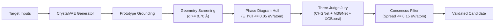

# MatChain — Materials Pipeline & Scientific Validation Manual

**Version:** 2.0  
**Authors:** Senior Computational Materials Scientist & AI/ML Systems Engineer  
**Scope:** Generative Modeling, Crystal Geometry, Thermodynamic Hull Screening, Multi-Surrogate AI Jury & Consensus Verification

---

## 1. Overview of the Discovery Pipeline

The MatChain materials discovery pipeline transforms user-defined thermodynamic and structural targets into verified crystal structures through a multi-stage validation funnel. Every candidate must satisfy geometric viability, thermodynamic meta-stability, and unanimous consensus across three independent machine learning potentials before being accepted.

---

## 2. Mathematical & Physical Formulations

### 2.1 Geometry Validation & Collision Detection
To prevent unphysical atomic overlap that causes universal interatomic potentials to produce singularities or unphysical energies, candidate lattices are screened across all periodic images:

$$d_{\min} = \min_{i \ne j, \mathbf{R} \in \mathbb{Z}^3} \|\mathbf{r}_i - \mathbf{r}_j + \mathbf{R}\mathbf{L}\|$$

- **Threshold:** $d_{\min} \ge 0.70\text{ \AA}$
- Any candidate with $d_{\min} < 0.70\text{ \AA}$ is discarded with reason code `ATOMIC_COLLISION`.
- Additional geometric invariants:
  - Unit cell volume: $V_{\text{cell}} \ge 10.0\text{ \AA}^3$
  - Physical density: $\rho \ge 0.10\text{ g/cm}^3$

### 2.2 Thermodynamic Formation Energy ($\Delta H_f$)
Universal machine learning potentials (CHGNet, M3GNet) predict total cohesive potential energy ($E_{\text{total}}$). Formation energy $\Delta H_f$ is defined relative to standard elemental ground states at 0 K:

$$\Delta H_f = \frac{E_{\text{total}}(S)}{N} - \sum_{i=1}^K x_i \mu_i^0$$

Where:
- $N$ is the total number of atoms in the unit cell.
- $x_i$ is the atomic fraction of species $i$ ($\sum x_i = 1$).
- $\mu_i^0$ is the calibrated chemical potential of element $i$ in its standard ground-state reference structure (e.g., BCC Fe, FCC Al, HCP Ti, Diamond Si).

### 2.3 Energy Above Convex Hull ($E_{\text{hull}}$)
Thermodynamic stability is determined relative to the Materials Project phase diagram:

$$E_{\text{hull}} = \Delta H_f(c) - E_{\text{PD}}(c)$$

Where $E_{\text{PD}}(c)$ is the convex hull energy at composition $c$ formed by the convex lower envelope of all stable phases:

$$E_{\text{hull}} \le 0.05\text{ eV/atom}$$

- **Threshold Justification:** Candidates within $0.05\text{ eV/atom}$ ($~2 k_B T$ at room temperature) are considered experimentally synthesizable as metastable phases (e.g., diamond, martensite).
- Any candidate with $E_{\text{hull}} > 0.05\text{ eV/atom}$ is discarded with reason code `THERMODYNAMIC_UNSTABLE`.

### 2.4 Multi-Model Jury Consensus Spread ($\tau$)
Three independent models evaluate every candidate that passes thermodynamic screening:
1. **CHGNet** ($\text{Model}_1$): Graph Neural Network with atomic charge featurization and multi-body interactions.
2. **M3GNet** ($\text{Model}_2$): Materials Graph Neural Network with explicit 3-body angles and bond lengths.
3. **XGBoost** ($\text{Model}_3$): Gradient boosted decision tree regression on 132 Magpie elemental compositional descriptors.

The jury consensus spread is calculated as the maximum pairwise disagreement:

$$\text{Spread} = \max_{m \in \{1, 2, 3\}} E_m - \min_{m \in \{1, 2, 3\}} E_m$$

- **Threshold:** $\text{Spread} \le 0.15\text{ eV/atom}$ ($\tau$)
- **Strict Consensus Rule:** All 3 models must return valid finite predictions. If any model is missing or fails, the candidate is marked `evaluation_incomplete` (`JUDGE_PREDICTION_FAILED`).
- If $\text{Spread} > \tau$, the candidate is rejected with reason code `SPREAD_EXCEEDS_TAU`.

---

## 3. Prototype Grounding Algorithm

Unconditioned coordinate generation in continuous space frequently places atoms in unphysical configurations without crystallographic symmetry. To solve this, MatChain implements **Prototype Grounding**:

1. **Symmetry Mapping**: Identifies the chemical stoichiometry and assigns it to a crystallographic space group prototype:
   - **Elemental ($A$)**: BCC ($Im\bar{3}m$), FCC ($Fm\bar{3}m$), HCP ($P6_3/mmc$), Diamond ($Fd\bar{3}m$).
   - **Binary Rocksalt ($AB$)**: $Fm\bar{3}m$ symmetry (e.g., MgO, TiC, NaCl).
   - **Binary Sphalerite ($AB$)**: $F\bar{4}3m$ symmetry (e.g., ZnS, GaAs).
   - **Binary Cesium Chloride ($AB$)**: $Pm\bar{3}m$ symmetry (B2 phase).
   - **Ternary Perovskite ($ABO_3$)**: $Pm\bar{3}m$ symmetry (corner A, body-center B, face-centered oxygen).
2. **Lattice Parameter Scaling**: Continuous lattice vectors $[a, b, c, \alpha, \beta, \gamma]$ decoded from the generative model scale the prototype cell while preserving fractional site symmetries.
3. **Relaxation**: Candidate structures undergo optional CHGNet `StructOptimizer` relaxation to minimize atomic forces while preserving space group invariants.

---

## 4. Diagnostic Reason Codes & Mathematical Accounting

MatChain enforces strict mathematical conservation laws on every generation batch:

$$\text{Generated} = \text{Valid Geometry} + \text{Collision Rejections} + \text{Duplicate Rejections}$$
$$\text{Thermodynamic Screened} = E_{\text{hull}}\text{ Passed} + E_{\text{hull}}\text{ Rejected}$$
$$\text{Jury Evaluated} = E_{\text{hull}}\text{ Passed}$$
$$\text{Jury Evaluated} = \text{Consensus Passed} + \text{Spread Exceeded} + \text{Jury Incomplete}$$
$$\text{Final Validated Candidates} = \text{Consensus Passed}$$

### Diagnostic Code Reference Table:

| Reason Code | Pipeline Stage | Definition & Trigger Condition |
|---|---|---|
| `ATOMIC_COLLISION` | Geometry Validation | Minimum interatomic distance $d_{\min} < 0.70\text{ \AA}$ across periodic boundaries. |
| `UNPHYSICAL_VOLUME` | Geometry Validation | Unit cell volume $V < 10.0\text{ \AA}^3$ or density $\rho < 0.10\text{ g/cm}^3$. |
| `DUPLICATE_CANDIDATE` | Diversity Filter | Candidate has identical reduced formula and density to an existing candidate in the batch. |
| `THERMODYNAMIC_UNSTABLE` | Hull Screening | Energy above convex hull $E_{\text{hull}} > 0.05\text{ eV/atom}$. |
| `SPREAD_EXCEEDS_TAU` | Jury Consensus | Model disagreement $\max(E_i) - \min(E_i) > 0.15\text{ eV/atom}$. |
| `JUDGE_PREDICTION_FAILED` | Jury Consensus | One or more of the 3 required judges failed to compute a finite prediction. |
| `PASSED_ALL_CRITERIA` | Final Acceptance | Successfully satisfied geometry ($d \ge 0.70\text{ \AA}$), hull ($E_{\text{hull}} \le 0.05\text{ eV}$), and unanimous consensus ($\text{Spread} \le 0.15\text{ eV}$). |

---

## 5. Why Candidates Get Accepted vs. Rejected

In materials discovery, generating high-entropy continuous representations frequently explores regions of phase space that are thermodynamically unfavorable. 

- **Acceptance is rare and rigorous**: An acceptance rate of $5\text{--}15\%$ is standard for realistic materials screening.
- **Zero Accepted Candidates is Scientifically Normal**: When sampling challenging target parameters (e.g., negative formation energy with high band gap), candidates frequently land $>0.05\text{ eV/atom}$ above the hull. The system honestly rejects them rather than artificially altering physical thresholds.
- **Model Disagreement Highlights Uncertainty**: When CHGNet and M3GNet agree but XGBoost disagrees, it indicates that local bond geometries violate the composition-level prior, demonstrating the necessity of the 3-judge ensemble.

